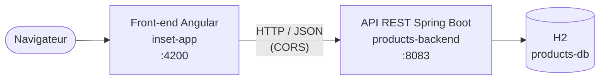
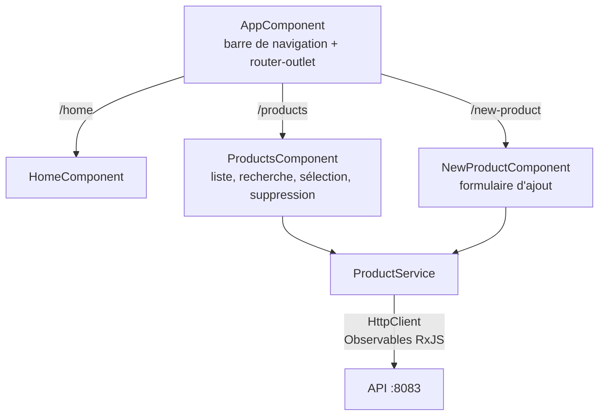
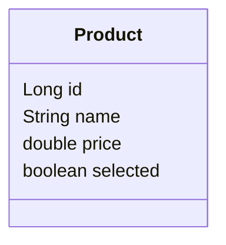
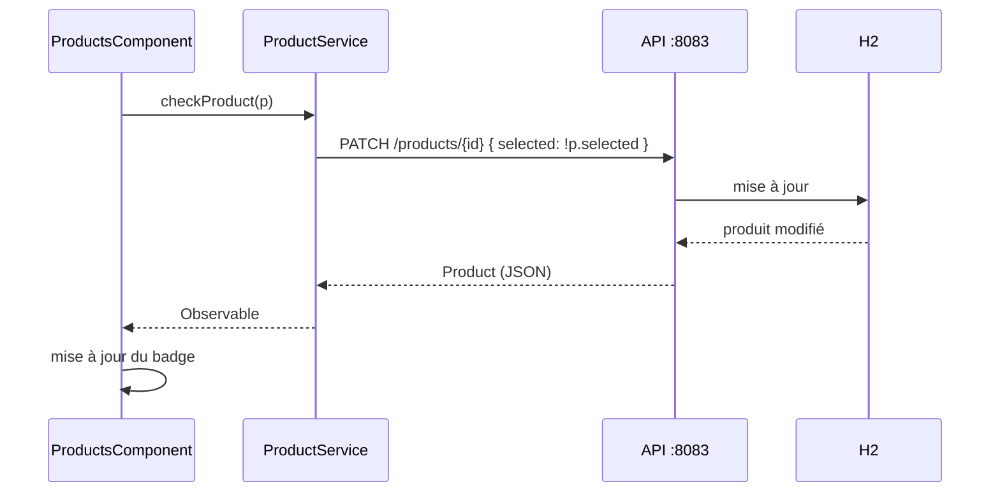

# Inset — Gestion de catalogue produits


Application web de **gestion de catalogue produits**. Elle se compose d'un front-end **Angular** (composants standalone) et d'une API REST **Spring Boot**.

Elle permet de consulter, d'ajouter, de rechercher et de supprimer des produits, ainsi que de basculer leur statut de sélection, le tout avec une interface responsive.

---

## Fonctionnalités

- **Catalogue** : liste des produits, avec leur prix et leur statut.
- **Ajout** : formulaire réactif, avec validation des champs.
- **Sélection** : un clic sur le badge de statut bascule le produit entre sélectionné et non sélectionné. Le changement est enregistré côté serveur.
- **Suppression** : avec demande de confirmation.
- **Recherche** : filtrage instantané par nom, pendant la saisie.

---

## Architecture



Le front-end et l'API tournent sur deux origines différentes (ports `4200` et `8083`). L'API autorise donc explicitement les requêtes inter-domaines, avec `@CrossOrigin`.

### Front-end



- **Composants standalone** : aucun `NgModule`. Chaque composant déclare lui-même ses dépendances.
- **`ProductService`** : il centralise tous les appels HTTP et il est injecté dans les composants.
- **Templates** : ils utilisent les blocs de contrôle de flux `@if`, `@for` et `@empty`.

---

## Modèle de données



---

## API REST

URL de base : `http://localhost:8083`

| Méthode | Endpoint | Description |
|---|---|---|
| `GET` | `/products` | Liste des produits |
| `GET` | `/products/{id}` | Détail d'un produit |
| `POST` | `/products` | Création d'un produit |
| `PATCH` | `/products/{id}` | Mise à jour du statut `selected` |
| `DELETE` | `/products/{id}` | Suppression d'un produit |

Exemple de produit :

```json
{ "id": 1, "name": "Ordinateur Portable", "price": 1300.0, "selected": true }
```

**Exemple de flux : basculer le statut d'un produit**



---

## Stack technique

| Couche | Technologies |
|---|---|
| Front-end | Angular 22, TypeScript, RxJS, Reactive Forms, Bootstrap 5, Bootstrap Icons |
| Back-end | Java 25, Spring Boot 4, Spring Web MVC, Spring Data JPA, Lombok |
| Base de données | H2 (en mémoire) |
| Build | npm, Maven |

---

## Démarrage

### Prérequis

- Node.js 22.22.3+ ou 24.15+
- JDK 25
- Maven 3.9+ (ou un IDE comme IntelliJ IDEA)

### 1. Lancer l'API

```bash
cd products-backend
mvn spring-boot:run
```

L'API est alors disponible sur http://localhost:8083/products. Au démarrage, elle crée trois produits de démonstration.

### 2. Lancer le front-end

```bash
cd inset-app
npm install
npm start
```

L'application est alors disponible sur **http://localhost:4200**.

> La base H2 est en mémoire : les données reviennent à leur état initial à chaque redémarrage de l'API.

---

## Structure du projet

```text
.
├── inset-app/                     # Front-end Angular
│   └── src/app/
│       ├── home/                  # Page d'accueil
│       ├── products/              # Catalogue : liste, recherche, sélection, suppression
│       ├── new-product/           # Formulaire d'ajout
│       ├── services/              # ProductService (appels HTTP)
│       ├── app.routes.ts          # Routes
│       └── app.config.ts          # Configuration (router, HttpClient)
└── products-backend/              # API REST Spring Boot
    └── src/main/java/hakim/ma/productsbackend/
        ├── entities/              # Product
        ├── repository/            # ProductRepository
        └── web/                   # ProductRestController
```

---

## Auteur

**Ilyass Hakim** · [GitHub](https://github.com/Ilyass-Hakim)
